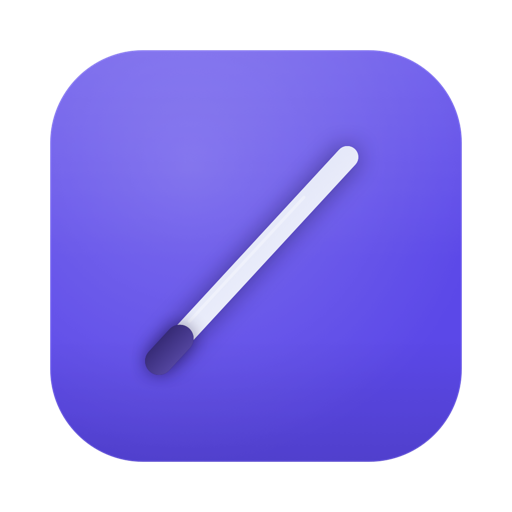

<p align="center">
  
</p>

<h1 align="center">Baton</h1>

<p align="center">
  macOS 菜单栏工具箱：截图标注 · 贴图 · OCR · 翻译 · 剪贴板历史 · 输入法记忆 · 平滑滚动
</p>

<p align="center">
  <a href="https://selierlin.github.io/baton/">产品主页</a> ·
  <a href="https://selierlin.github.io/baton/features.html">功能介绍</a> ·
  <a href="https://github.com/selierlin/baton/releases">下载</a> ·
  <a href="docs/engineering.md">工程笔记</a>
</p>

---

平时散在四五个 App 里的活——截图、框一下、钉在屏幕上、把图里的字取出来翻译、翻回半小时前的剪贴板——
Baton 收进一个菜单栏图标里，用一套快捷键串起来。

原生 Swift 6 + AppKit 写的，没有 Electron，不驻留轮询；数据全部存在本机。

## 能做什么

| | 能力 | 一句话 |
|---|---|---|
| 📸 | **截图** | 区域 / 窗口 / 元素三种框选，放大镜带坐标与色值，圈完直接标注 |
| 🖊 | **标注** | 方框、椭圆、箭头、画笔、马赛克、高亮、文字、序号、尺规，全可撤销 |
| 📌 | **贴图** | 截图钉在屏幕上当参考，滚轮缩放、`R` 收成缩略图、随时再贴一张 |
| 🔤 | **OCR** | 本机 Vision 免费离线，也可接百度 / 腾讯（自带密钥），二维码一并识别 |
| 🌐 | **翻译** | 划词翻译 / 截图翻译，OpenAI 兼容族（DeepSeek、Kimi、Ollama…）与百度、腾讯 |
| 📋 | **剪贴板历史** | 文字 / 图片 / 文件 / 颜色，粘贴栈、侧滑预览、图里的字也能搜到 |
| ⌨️ | **输入法记忆** | 按 App、按网站、按输入框记住输入法，地址栏自动切英文 |
| 🖱 | **平滑滚动** | 一格滚轮摊成几十帧，曲线照 Mos 那套调，鼠标也滚得像触控板 |
| 📏 | **长截图 / 尺子 / 录屏** | 滚动截图自动拼接，屏幕尺子取色测距，四种模式的录屏带系统声音 |

## 安装

系统要求：**macOS 15 (Sequoia) 或更高**，Apple 芯片。

1. 到 [Releases](https://github.com/selierlin/baton/releases) 下载最新的 `Baton.zip`
2. 解压后把 `Baton.app` 拖进「应用程序」
3. 首次打开请**右键 → 打开**（应用未做 Apple 公证，双击会被 Gatekeeper 拦下）
4. 按提示授予权限：屏幕录制（截图 / 录屏）、辅助功能（元素截图、划词）、输入监控（平滑滚动）

> 只在用到对应功能时才需要授权，全部拒绝也能当普通截图工具用。

### 从源码构建

```bash
git clone https://github.com/selierlin/baton.git
cd baton
swift build && swift test
./Scripts/make-app.sh release --install   # 打包并装到 /Applications
```

需要 Xcode 16+（Swift 6）。`make-app.sh` 会优先用本机的 Apple Development 证书签名，
没有就退回 ad-hoc——**ad-hoc 每次重建签名都会变，系统里的权限授权会失效**，日常用建议配一张开发证书。

## 快捷键

默认值，全部可以在 设置 → 热键 里改，也可以取消绑定。

| 动作 | 快捷键 | | 动作 | 快捷键 |
|---|---|---|---|---|
| 区域截图 | `⌥⌘A` | | 截图贴图 | `⌥⌘P` |
| 截图 OCR | `⇧⌘O` | | 截图翻译 | `⇧⌘Y` |
| 划词翻译 | `⇧⌘T` | | 剪贴板历史 | `⇧⌘V` |
| 长截图 | `⌥⌘L` | | 屏幕尺子 | `⌥⌘R` |
| 全屏截图 | `⌃⌘1` | | 截取上一次区域 | `⌃⌘2` |
| 延迟截图 | `⌃⌘4` | | 回溯上一次截图 | `⌃⌘5` |
| 截取活动窗口 | `⌃⌘6` | | 隐藏 / 显示所有贴图 | `⌃⌘7` |
| 区域录制 | `⌃⌘8` | | 全屏录制 | `⌃⌘9` |

## 隐私

- **不上传任何东西**。除了你自己配置的云服务（百度 OCR、腾讯云、翻译 API），Baton 不联网。
- 剪贴板库、贴图、配置都在 `~/Library/Application Support/Baton/`，日志在 `~/Library/Logs/Baton/`。
- 密码管理器标记为「机密 / 临时」的剪贴板内容**一律不落库**。
- OCR 默认走本机 Vision，完全离线。
- 云服务密钥存在系统钥匙串，不写配置文件。

## 文档

- [工程笔记](docs/engineering.md)：模块划分、接口边界、踩过的坑
- [截图验收矩阵](docs/capture-test-matrix.md) · [贴图验收矩阵](docs/pin-test-matrix.md)
- 日志：设置 → 通用 → 关于 → 打开日志文件夹

## 许可证

[MIT](LICENSE)。用得上的话，欢迎提 issue 和 PR。

---

<sub>Baton 最初是作者个人的一个「把常用小工具合并成一个」的实验，界面与交互参考了 macOS 系统工具和若干同类应用的使用习惯。</sub>
